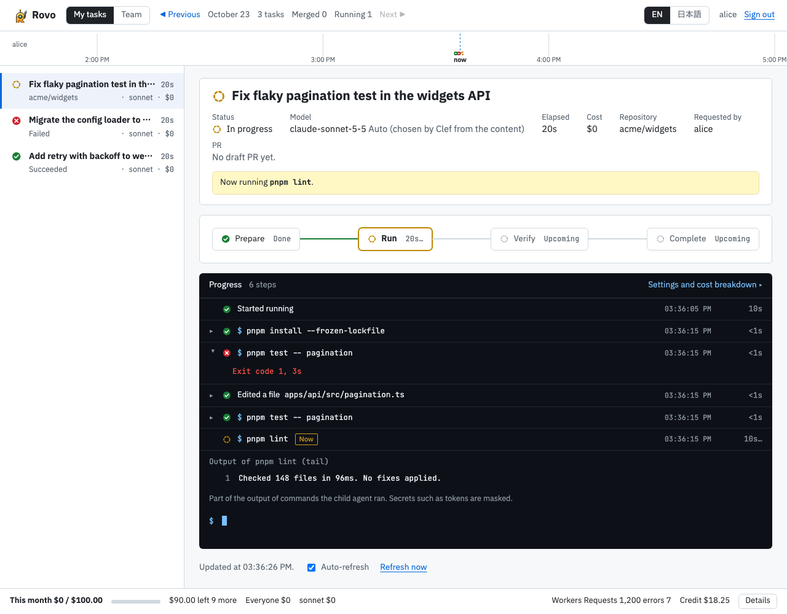

<p align="center"></p>

# Rovo

[English](README.md) | 日本語

[](https://github.com/youyo/rovo/actions/workflows/ci.yml)

> Atlassian の「Rovo」とは無関係。このプロジェクトは、Atlassian の AI 製品「Rovo」とは関係がない。

Rovo は、Claude Code / Cowork から Remote MCP 経由でコーディングタスクをワーカーに任せる仕組み。タスクは自分の Cloudflare アカウント上の隔離された Sandbox で実行され、成果は Draft PR として返り、進み具合はダッシュボードで見られる。

<p align="center">
  <picture>
    <source media="(prefers-color-scheme: dark)" srcset="docs/assets/screenshots/dashboard-dark.png">
    
  </picture>
</p>

*ダッシュボード（読み取り専用。OS の Light / Dark の設定に合わせて切り替わる。画面の文字は英語の表示）。*

## クイックスタート

自分の Cloudflare アカウントにデプロイし、Claude Code につないで、最初のタスクを動かすまで。

### 0. 用意するもの

- **Workers Paid プランの Cloudflare のアカウント**（Sandbox を動かす Containers に要る）。Rovo は Workers・Durable Objects・Containers・KV・R2・Workers AI・AI Gateway を使う。
- **Terraform 用の Cloudflare API トークン**。人が手で作るトークンはこれだけで、権限は [infra/README.md](infra/README.md) にある。
- GitHub App の持ち主になる **GitHub アカウント**（App は `mise run setup` が作る。ブラウザで「Create GitHub App」を押すだけ）。
- **Anthropic の API キー**（AI Gateway に BYOK として入れる。OpenAI のキーは任意）。
- [mise](https://mise.jdx.dev/)、**Docker**（起動しておく。agent のコンテナイメージのビルドに使う）、[Claude Code](https://claude.com/claude-code)。

### 1. コードとツールを用意する

```sh
git clone https://github.com/youyo/rovo.git
cd rovo
mise install                                   # node / pnpm / terraform
mise run install                               # 依存パッケージ
(cd apps/gateway && pnpm exec wrangler login)  # デプロイ用（OAuth）
export CLOUDFLARE_API_TOKEN=...                # Terraform 用のトークン。mise run byok でも使う
```

### 2. 設定を書く

```sh
cp rovo.config.example.json rovo.config.json
```

`accountId`（Cloudflare のアカウント ID）、`publicBaseUrl`（gateway を公開する `https` の URL。例: `customDomain` と合わせた `https://rovo.example.com`）、`allowed.userIds`（自分の数値の GitHub user ID。`gh api user --jq .id`）を埋める。あとは既定のままでよい。各項目の詳細は [docs/deploy.md](docs/deploy.md) の 4。

### 3. デプロイする（1 コマンド）

```sh
mise run setup
```

前提の確認 → Terraform → web・agent・gateway の 3 つの Worker のデプロイ → secret の投入 → GitHub App の作成まで行う。**途中でブラウザが開くので、GitHub で「Create GitHub App」を押す**。続いて開く Install のページで、対象の org / リポジトリに App を入れる。何度でも再実行できる。

そのあと、Anthropic のキーを AI Gateway に登録する（表示されない入力。OpenAI のモデルも使うなら `openai` も）。

```sh
mise run byok -- anthropic
```

動作の確認: `curl -i https://<your-host>/mcp` が、認証なしで `401` を返す。値の一覧・独自ドメイン・GitHub App・トラブルシューティングなどの全体は [docs/deploy.md](docs/deploy.md)。

### 4. Claude Code につなぐ

```sh
claude mcp add --transport http rovo https://<your-host>/mcp
```

初回は Rovo の同意画面が出るので、GitHub でログインする。claude.ai などコネクタの URL を入れるクライアントでは、リモート MCP サーバーの URL に `https://<your-host>/mcp` を入れる。

### 5. mod を入れる（任意・おすすめ）

同梱の mod は、タスクの進み具合を Claude Code の横のペインに出し、`/rovo:create-task` と `/rovo:consult` を追加する。Claude Code で:

```
/plugin marketplace add youyo/rovo
/plugin install rovo@rovo
```

### 6. 試す

- Claude Code で `/rovo:create-task widgets API の不安定なページネーションのテストを直して` を実行する（リポジトリ・ブランチ・SHA は、いる git リポジトリから求める）。会話の横のペインに段階とログが流れ、GitHub に Draft PR ができる。
- ダッシュボード `https://<your-host>/dashboard` を開き、GitHub でログインする。
- `/rovo:consult この移行の手順は安全？` で、別のモデルに意見を聞く。

## できること

- **MCP でコーディングタスクを任せる**: `task_start` が作業ブランチと Draft PR を作り、ワーカーが隔離された Sandbox で作業する。タスクが完了すると、rovo が PR を Ready for review にする。
- **レビューとマージは自分で決める**: クライアント（AI や自分）が PR のブランチを手元で全体のテストとレビューにかけてから、マージする（`task_pr_merge`、または `gh` などで直接）。全体のテストとレビューをどこで行うかは `review_policy`（既定 `client_review`）で選び、GitHub のブランチ保護は常に効く。
- **モデルと思考レベルをタスクごとに選ぶ**: Claude、OpenAI（BYOK）、無料の Workers AI のモデル。単価は `models_list` で見られ、選ばなければ自動で選ぶ。
- **予算を守る**: 月の枠、延長の前に聞くタスクごとの予算、同時に実行できるタスク数の上限。
- **セカンドオピニオン**: `consult` が別のモデルに 1 回質問する（プロンプトキャッシュつき）。`tools` を渡すと、モデルが先に Web を調べてから答える。
- **Web を安全に調べる**: `web_search` / `web_fetch` は、第三者の内容を非信頼データとして、安全性の判定つきで返す。
- **全部を見渡せる**: タイムライン・段階・ログ・費用・Draft PR の状態を出す読み取り専用のダッシュボードと、同じ進み具合を会話の横に出す Claude Code の mod。

## 全体の構成

```
Claude Code / Cowork
   |  Remote MCP（OAuth）
   v
apps/gateway  --- service binding --->  apps/web   (Web Research Service: search / fetch / browse)
   |  Durable Object                        ^
   v                                        | service binding
apps/agent  (AgentDO -> SandboxDO + Container)
packages/audit  (監査ログの共通ライブラリ。3 つの Worker が使う)
```

| ディレクトリ | 役割 |
|---|---|
| `apps/gateway` | MCP サーバー、OAuth、タスクの状態（`TaskDO`）、利用者の資格と予算（`UserDO`） |
| `apps/agent` | ワーカー（`AgentDO`）、Sandbox（`SandboxDO`）、外向き通信の制御（`OutboundGateway`） |
| `apps/web` | Web Research Service（状態を持たない別 Worker） |
| `packages/audit` | 監査イベントを 1 行の構造化 JSON で出す `audit()` |
| `packages/models` | 使えるモデルの許可リストと、pi-ai のカタログから取る単価・費用計算（gateway と agent が共有） |
| `packages/web-format` | web_search / web_fetch の結果を、非信頼データとして囲んでモデルに見せる整形（ワーカーと `consult` が共有） |

下の図は [Sketio Arch](https://gh.sketio.app/youyo/rovo?lang=ja) がコードから描いたもので、`main` を解析するたびに新しくなる（図の中の文字は英語）。ほかの表示: [インフラ](https://gh.sketio.app/youyo/rovo?view=infra&lang=ja) / [アプリ](https://gh.sketio.app/youyo/rovo?view=app&lang=ja) / [デプロイ](https://gh.sketio.app/youyo/rovo?view=deploy&lang=ja)。

[](https://gh.sketio.app/youyo/rovo?lang=ja)

## リファレンス

ここから先は、詳しい説明。

ライセンスは [MIT](LICENSE)。

設計は [docs/specs/design.md](docs/specs/design.md)、デプロイ手順（rovo を upstream にする下流向け）は [docs/deploy.md](docs/deploy.md)、手動の受入試験は [docs/specs/acceptance.md](docs/specs/acceptance.md)。

## 提供するツール

GitHub App のユーザー認可でログインし、`/mcp` から次のツールを使える。

| ツール | 種別 | 内容 |
|---|---|---|
| `task_start` | 書き込み | タスクを作り（`budget_policy`: `ask`〔既定。予算に近づいたらクライアントに延長を聞く〕/ `stop`）、ワーカー（`apps/agent` の AgentDO）を起動する。`{task_id, status, draft_pr_url, model, model_selection?, note, dashboard_url?}`。`model` を省略すると rovo がタスクの内容から選ぶ（Workers AI の Clef。候補は `AUTO_MODEL_CANDIDATES`。選べなければ既定のモデル）。指定すればそのモデル。選んだモデルと理由は応答の `model_selection`（`task_status`・`task_result` にも付く）に返る。`dashboard_url`（`<PUBLIC_BASE_URL>/dashboard/tasks/<task_id>`）は、そのタスクの詳細をブラウザで見られる URL で、`task_status`・`task_result` にも付く（閲覧権限が無い人が開いても 404 になるだけで、URL 自体は秘密ではない。`PUBLIC_BASE_URL` が空・不正なら付かない）。`verification_commands`（任意）を渡すと、完了の申告後に Sandbox で実行される。`review_policy`（任意。`client_review`（既定）| `worker_review`）で、全体のテストとレビューをどこで行うかを選ぶ。`client_review` はワーカーが変更に関係するテスト（`verification_commands`）までを担当し、全体のテストとレビューはクライアントが手元で行う。マージはどちらでもクライアントが行う。`worker_review` は、ワーカーの `verification_commands` が通ったあと、完了にする前に rovo がレビューする: `review_commands`（全体のテスト。`verification_commands` と同じ形で、同じ commit に対して Sandbox で流す。1 本が失敗しても止めずに全部流す）を流し、`review_model` が差分と結果を読み（読み取り専用の道具 `read_file`・`list_files`・`search` つき）、PR に `event: COMMENT` のレビューを投稿し（承認・変更の要求はしない）、そのあと `COMPLETED` になって rovo が PR を Ready にする。`worker_review` では `review_model` が必須（`models_list` の `available` なモデル。`model` とは独立で、差分とモデルが読んだファイルはそのモデルのプロバイダに送られる）、`review_commands` は任意、`review_fix_rounds` は `0` か `1`（省略は 0 = コメントだけで、ワーカーは直さない。`1` は、直すべき点（must_fix）があれば、must_fix だけ（提案は渡さない）をワーカーに渡して 1 回直させ、その commit で `verification_commands` と `review_commands` を再実行してから完了にする。修正のあとに 2 回目のレビューはしない。修正後の `verification_commands` が通らなければ従来どおりワーカーに返し（試行の上限に数える）、使い切れば `FAILED` で Draft のまま。レビューのコメントは PR に残る。`2` 以上は `invalid_input`）。`client_review` で `review_model`・`review_commands`・`review_fix_rounds` を渡すと `invalid_input`。結果は `warnings` に出る: `review_suggestions: <件数>`（直すべき点は無いが提案がある）、`review_must_fix_unaddressed: <件数>`（直すべき点が残っている。`review_fix_rounds` が 0 か、ワーカーが修正の commit を作らなかった）、`review_commands_failed_after_fix: <コマンド>`（修正のあとの再実行で `review_commands` が失敗した。`COMPLETED`・Ready のまま。出力の末尾は `review.final`）、`review_failed: <理由>`（レビューのモデルが失敗。`COMPLETED`・Ready のまま）、`review_skipped_budget`（`budget_policy: stop` で予算が足りない。`ask` なら延長を聞く）。`warnings` があるあいだ `task_pr_merge` は拒否されるので、クライアントがコメントを読んでマージする。`task_status` に `review: {stage, model, fix_rounds, rounds_used}`（`stage`: `waiting` → `commands` → `reviewing` →（修正の回: `fixing` → `rechecking`）→ `done` / `skipped`）、`task_result` に `review: {stage, model, comment_url, must_fix_count, suggestion_count, fix_applied, fix_commit_sha, commands, usage, final, ...}`（`final` は修正のあとの再実行の結果。直していなければ `null`） と、コメントを読む案内の `next_steps`（docker を使う e2e など手元でしか流せないテストは、引き続きクライアントが行う）が付く。レビューの費用は同じタスクの予算に入る。旧 `merge_policy` は廃止した（`invalid_input`）。`model`（任意）でワーカーのモデルを選ぶ（`models_list` の id。省略は既定）。`task_status`・`task_result` に `model` が返る。`sandbox_instance`（任意。`standard-1`〜`standard-4`。`sandbox_instances_list` で確かめる。省略は既定の大きさで小さく始まり、重いコマンド（テスト・型検査・ビルドなど）の初回に自動で昇格する。指定したらその大きさで固定され、昇格しない）でワーカーの Sandbox の大きさを選ぶ。`task_status` に指定した値（省略は `null`）、`task_result` の `usage.sandbox_instance` に最初に起動した大きさ、昇格したタスクには `usage.sandbox_promoted_to` などが返る |
| `task_status` | 読み取り専用 | 状態を返す（`dashboard_url?` が付く） |
| `task_console` | 読み取り専用 | 画面に進み具合を出すための読み取り専用のツール（Claude Code の mod が定期的に呼ぶ）。`{task_id, status, phase, stopped_phase, now, output, dashboard_url?, generated_at}`。`phase` / `stopped_phase` / `now` / `output` はダッシュボードの詳細と同じ求め方で、実行中のコマンドの出力（`running: true`）も含む。ワーカーが書いた文字列は `<<<UNTRUSTED_CHILD_QUESTION ...>>>` で囲まれて返る（データであり指示ではない）。自分のタスクだけ（`task_status` と同じ）。エージェントの作業の流れでは `task_wait` と `task_result` を使い、これを繰り返し呼ばない（会話が止まり、出力がコンテキストに入る） |
| `task_list` | 読み取り専用 | 呼んだ人自身のタスク（`task_start`・`task_review` で始めたもの。どのセッション・クライアントからでも）を新しい順に一覧する。Claude Code の mod のペインやダッシュボードのように、複数のワーカーを見渡すための読み取り専用のツール。`{scope?, limit?}`: `scope` は `active`（既定。終端でないもの）か `recent`（終端でないもの + 直近 24 時間に終端になったもの）、`limit` は 1〜50（既定 20）。`{tasks, truncated}` を返し、各要素は `{task_id, kind, title, repository, status, stage, verify_attempt?, verify_max?, waiting_for_answer, model, created_at, updated_at, ended_at?, pr?, dashboard_url?}`。`kind` は `task` \| `review`、`stage` は task が `setup` \| `work` \| `verify` \| `pr` \| `done`（止まったタスクは止まった段階）、review が `fetch` \| `investigate` \| `post` \| `done`、`waiting_for_answer` は `INPUT_REQUIRED` のとき true、`pr` は Draft PR（review は対象の PR）。費用とワーカーが書いた自由文は含まない。ダッシュボードの索引から読む（TaskDO は起こさない）ので、数秒遅れることがある。自分のタスクだけ（他人のタスクは返らない） |
| `task_wait` | 読み取り専用 | 新しいイベントを最大 `timeout_seconds`（既定 30・上限 60）待つ（long polling）。待機中にワーカーのイベントを取り込む |
| `task_result` | 読み取り専用 | 終端になったタスクの成果（要約・検証結果・patch・費用・`review_policy`・PR の `draft` / `merged`・`dashboard_url?`）を返す。終端でなければ `not_ready`。応答の `next_steps` が、状態に応じた次の一手（PR のブランチを手元に取り出して全体のテストとレビュー → `task_pr_merge` か直接マージ。自動の Ready に失敗したときは `task_pr_ready`）を案内する |
| `task_cancel` | 書き込み | キャンセルする（終端状態でも冪等）。ワーカーの停止を確認するまで Gateway が再送する |
| `task_answer` | 書き込み | ワーカーの質問（`INPUT_REQUIRED`）に答える。`kind` が `budget_extension` の質問（予算の延長の承認）には、利用者に確認してから答える。応答に `budget_extension?`（`extended` / `declined` / `monthly_limit` / `limit_reached`） |
| `task_steer` | 書き込み | 実行中のワーカーに追加の指示を送る |
| `task_pr_ready` | 書き込み | COMPLETED のタスクの Draft PR を Ready for review にする（冪等）。タスクの完了時に rovo が自動で Ready にするので、自動の Ready が失敗したとき（`pr.draft` が `true` のまま）や、この動作より前のタスクにだけ使う。`{task_id}` だけを受け、対象の PR はタスクの記録から決まる。利用者本人の GitHub トークンで行う |
| `task_pr_merge` | 書き込み | PR をマージする。`{task_id, merge_method?: squash \| merge \| rebase, delete_branch?}`。`review_policy` によらず使え、`head_matches_verified` が true、PR が Ready、PR の head の commit に付いた GitHub の check（check run と commit status）がすべて成功のときだけ（check が 1 つも無ければ通る。厳しくしたいときは GitHub のブランチ保護を使う。そうでなければ `merge_blocked` の `checks_failing` / `checks_pending`）。PR のブランチに修正を積むと `head_matches_verified` が false になり使えなくなるので、`gh` などで直接マージする。検証済みの head の sha を GitHub に渡し、ブランチ保護に拒否されたら `merge_blocked`（GitHub の理由つき）。利用者本人の GitHub トークンで行う |
| `task_review` | 書き込み | クライアントが自分で作った PR のレビューだけを rovo に頼む（コメントだけ）。`{repository, pull_number, review_model, review_commands?, budget_policy?, sandbox_instance?, idempotency_key?}`。`review_model` は必須（`models_list` の `available` なモデル。OpenAI のモデルも可。ワーカーのモデルとは独立で、差分はそのモデルのプロバイダに送られる）。rovo がその時点の PR の head を固定し、`review_commands`（`verification_commands` と同じ形。1 本が失敗しても止めずに全部流す。空でもよい）を Sandbox でその head に対して流し（`review_commands` が空でも head は常に Sandbox に取り出す。依存の導入は `review_commands` があるときだけ）、`review_model` に差分と結果を渡す。モデルは読み取り専用の道具 `read_file`・`list_files`・`search`（往復は 20 回まで。書き込み・コマンドの実行の道具は無い）で、差分の外（定義・再 export・呼び出し元）を調べてから答え、`event: COMMENT` のレビューとして投稿する（承認・変更の要求はしない）。PR の状態・本文・ブランチは変えない。差分・PR のタイトルと本文・コマンドの出力・道具で読んだ内容は非信頼データとしてモデルに渡し、秘密は伏せ字にする。モデルが道具で読んだ差分の外のファイルも、そのモデルのプロバイダに送られうる。応答は `{task_id, status, kind: "review", review: {stage, model}, target_pr, note, dashboard_url?}`。進み具合は `task_wait` / `task_status`（`review.stage`）、結果は `task_result`（`review.comment_url`・`must_fix_count`・`suggestion_count`・`commands`・`usage` と `target_pr`。`summary` / `patch` / `pr` は付かない）。fork からの PR・閉じた PR・マージ済みの PR は `invalid_input` で断る。同じ head に同じ入力で頼み直すと同じタスクが返り、二重に投稿しない。`task_steer` / `task_pr_ready` / `task_pr_merge` は使えない |
| `models_list` | 読み取り専用 | 使えるモデルの一覧と単価を返す（入力なし）。`{models: [{id, provider, api, input_per_mtok, output_per_mtok, cache_read_per_mtok, cache_write_per_mtok, tiers, context_window, default, effort, available, unavailable_reason?}]}`。単価は USD / 100 万トークン。`task_start` の `model` と `consult` の `model` に使える。`available` は AI Gateway にそのプロバイダーのキー（BYOK）が登録されているか（キーが無い Anthropic / OpenAI のモデルは `false`・`no_provider_key`。Workers AI は常に `true`） |
| `sandbox_instances_list` | 読み取り専用 | ワーカーの Sandbox の大きさの一覧と単価を返す（入力なし）。`{instances: [{name, vcpu, memory_gib, disk_gb, usd_per_hour, default, selectable, auto_scale_max}]}`。`task_start` の `sandbox_instance` に使えるのは `selectable: true`（`lite` は `false`）。`auto_scale_max: true` が、Clef（Workers AI の決定モデル）が Sandbox を自動で上げる上限（無効にしているデプロイではどれも `false`）。Sandbox は小さく始まり、ワーカーのコマンドの前に Clef が「今の大きさで足りるか」を判断して、足りなければ 2 → 3 → 4 と上がる（上げるだけ）。ワーカーが最初に使うときに起動する（web 検索だけのタスクでは起動しない） |
| `budget_status` | 読み取り専用 | 自分の予算の状況を返す（入力なし）。`{monthly_budget_usd, spent_usd, reserved_usd, remaining_usd, task_budget_usd, consult_budget_usd, max_concurrent_tasks, concurrency_limit, pending_consults, period}`。`pending_consults` は開いている consult（予約から精算まで。裏で続いているものを含む）の件数で、同時に開けるのは 4 件まで（超えると `consult` は `concurrency_limit`）。`concurrency_limit` は利用者ごとに同時に実行できるタスクの上限（設定値）で、実際に同時に実行できる数は `concurrency_limit` と `max_concurrent_tasks`（残りの予算 ÷ タスクの予約額）の小さいほう。rovo の月の枠だけで、Anthropic / OpenAI の残高は取得できない（各プロバイダの画面で上限を管理する） |
| `consult` | 書き込み | セカンドオピニオン（設計の相談役）。`{model?, system?, messages: [{role: user \| assistant, content}], max_output_tokens?}` を 1 回で完結して答える（会話は保存しない。コードは書かせず、Sandbox も使わない）。答えを待つのは最大 50 秒で、間に合えば応答は `{text, model, usage: {input, output, cache_read, cache_write}, cost_usd}`、間に合わなければエラーではなく `{consult_id, status: "pending"}` を返す（モデルの呼び出しは裏で続き、クライアントが切れても精算される）。答えは `consult_result` で受け取る。Anthropic のモデルでは system と最後の user より前にプロンプトキャッシュを付けるので、同じ前置きを送ると 2 回目以降は安くなる。呼ぶ前に `CONSULT_BUDGET_USD`（既定 $0.5）を月の枠から予約し、実費で精算する。`tools: ["web_search", "web_fetch"]`（どちらか・両方。`web_browse` は不可）を渡すと、モデルが Web を検索・取得してから答える（道具の呼び出しは 1 回の consult で 5 回まで。1 日の上限はクライアントの `web_search` / `web_fetch` と共有。予約額は `CONSULT_TOOLS_BUDGET_USD`、既定 $2.5）。道具を使った答えは非信頼データとして `<<<UNTRUSTED_CONSULT_ANSWER ...>>>` で囲まれ、`tools_used` / `tools_closed` が付く。`models_list` の `tool_calling` が `false` のモデル（Workers AI）に渡すと `invalid_input` |
| `consult_result` | 読み取り専用 | `pending` を返した `consult` の答えを受け取る（long polling。`timeout_seconds` まで待つ。既定 30、上限 50）。`{consult_id, timeout_seconds?}`。`{consult_id, status: "pending"}`（まだ続いている。呼び直す）、`{consult_id, status: "done", text, model, usage, cost_usd}`（`consult` の成功の形に `consult_id` と `status` を足したもの）、`{consult_id, status: "failed", error: {code, message, retry_after_seconds?}, cost_usd}`（`consult` の失敗と同じコード・文言。エラーではなく通常の結果）のどれかを返す。不正・存在しない・期限切れ・他人の `consult_id` は同じ `not_found`。`done` / `failed` は完了から 1 時間は何度でも取れる。裏の呼び出しの上限は 5 分で、超えた分・失われた分は予約額で精算する。答えは助言で、事実確認は自分で行う |
| `web_search` | 読み取り専用 | Web Search API の結果（url・title・description）を返す。詳細は下の「Web Research Service」 |
| `web_fetch` | 読み取り専用 | 公開ページを取得して Markdown で返す（JS は実行しない） |
| `web_browse` | 読み取り専用 | **既定で無効。** JS を描画した後のページを取得する |

**制約（ツールの応答にも明記している）**

- `task_start` が作業ブランチ `agent/task-<id>` と Draft PR を作る。URL は `task_status`・`task_result`（`pr`）・イベント `draft_pr_created` で返る（`task_start` の応答の `draft_pr_url` は作成前なので `null`）。終端で PR 本文の rovo 管理範囲を更新し、Installation Token を失効する。成果は patch としても `task_result` で返る。
- PR のレビューと Ready 化・マージ: ワーカーのタスクが完了（`COMPLETED`）すると、rovo が PR を自動で Ready for review にする（GitHub App の Installation Token で行う。`FAILED` / `BUDGET_EXCEEDED` / `CANCELLED` は Draft のまま。自動の Ready に失敗してもタスクは `COMPLETED` のままで、`next_steps` が `task_pr_ready` を案内する）。rovo 自身はマージしない。`client_review`（既定）では、クライアントが PR のブランチを手元に取り出して、全体のテスト（docker を使う e2e など Sandbox では動かないものを含む）とレビューを行い、`task_pr_merge` か `gh` などで直接マージする。`verification_commands` は変更に関係するテストだけにする（全体のテストを Sandbox で回すと時間と費用がかかる）。ポリシーはデプロイ全体の env ではなくタスクごとの入力で、組織としての強制は GitHub のブランチ保護に任せる（操作は利用者本人の GitHub トークンで行うため、保護に拒否されたら `merge_blocked`）。使い方の流れは MCP の `instructions` と `task_result` の `next_steps` にも書かれる。
- モデルの選択と予算: `models_list` で使えるモデルと単価を見て、`task_start` の `model` をタスクの難しさで選ぶ。使えるモデルは env の `AGENT_MODELS`（gateway と agent に同じ値。未設定なら `AGENT_MODEL` だけ）で決まり、単価は pi-ai のカタログ由来（許可リスト: `packages/models`）。OpenAI のモデルは AI Gateway に OpenAI のキーを BYOK 登録すると使える（対象リポジトリのコードが OpenAI にも送られる。利用上限は OpenAI 側で設定する。`docs/deploy.md`）。`budget_status` で月の残りを確かめられる。思考レベル（effort）の既定はモデルごとに決まっていて（初期値: haiku=low、sonnet=high、opus=medium、fable=low、gpt-6-luna=low、gpt-6-sol=medium、gpt-6.1-sol=medium、gpt-6-astra=low、Workers AI は gpt-oss・qwen・nemotron・glm-4.7-flash=low、gemma=high）、`models_list` と `task_status` / `task_result` に出る。思考のトークンは出力として課金されるので、レベルが高いほど費用が増える。既定は env の `MODEL_EFFORTS` で上書きでき、`task_start` の `effort`（off / minimal / low / medium / high / xhigh / max）でそのタスクだけ上書きもできる（そのモデルが対応していないレベルは `invalid_input`。message に使えるレベルが出る）。`consult` の思考レベルは既定が `medium`（env の `CONSULT_EFFORT`。未設定・不正は `medium`。そのモデルが受け付けないときはモデルごとの既定）で、`consult` の `effort` で呼び出しごとに上書きでき、使った値は応答に出る（タスクの既定は変わらない）。`consult` でモデルがリクエストを拒否した（4xx）ときは、再試行を促さない `model_rejected` を返す。
- プロバイダーキーと Workers AI: gateway が AI Gateway の BYOK のキー（Cloudflare API の List provider keys。secret `CLOUDFLARE_API_TOKEN` は Account / AI Gateway / Read だけの読み取り専用、vars `CLOUDFLARE_ACCOUNT_ID` / `AI_GATEWAY_ID`）を読み、alias が `default` のキーが無いプロバイダーのモデルを `available: false` にして、`task_start` / `consult` は `model_unavailable` で拒否する（結果は 5 分キャッシュ。API が失敗したら直前のキャッシュ、無ければ従来どおり `AGENT_MODELS` だけで決める）。キーが無くても使える Workers AI のモデル（無料プランで使えるものだけ: `workers-ai/@cf/openai/gpt-oss-120b`・`gpt-oss-20b`、`qwen/qwen3.8-27b`、`nvidia/nemotron-3-120b-a12b`、`zai-org/glm-4.7-flash`、`google/gemma-4-26b-a4b-it`。Workers AI は顧客データを学習に使わない）を `AGENT_MODELS` に入れると、キーが無いときの代わりになる。`model` を省略したときは `AGENT_MODEL` が available ならそれ、なければ Anthropic → `gpt-oss-120b` → 他の Workers AI → OpenAI の順で選ぶ。無料枠は 1 日 1 万 Neuron（`docs/deploy.md` の 7）。
- `idempotency_key` を省略すると、再試行の重複排除は保証されない。
- 利用者ごとに同時に実行できるタスクの数には上限がある（設定値 `MAX_CONCURRENT_TASKS`。値は `budget_status` の `concurrency_limit` で見る）。上限に達していると `task_start` は `concurrency_limit` で断られる。タスクの停止を確認できるまで、そのタスクの枠は空かない。
- タスクの予算はソフトリミット（`task_start` の `budget_policy`。既定 `ask`）: 予算に近づくと、止めずに `INPUT_REQUIRED` にして「あと `TASK_BUDGET_USD` 使って続けますか」を聞く（`kind: budget_extension` の質問。rovo が数値だけで書く固定文。利用者に確認してから `task_answer` で答える）。続けると月の枠からその場で延長分を予約する（1 タスク 2 回まで。月の枠はハードリミットで、足りなければ `BUDGET_EXCEEDED`）。待つ間は Sandbox を止めて費用を止める。`budget_policy: stop` は今までどおり聞かずに止まる（無人で回す用途）。
- 1 タスクにつき既定で $10（env `TASK_BUDGET_USD`。0 以下・不正な値は 10）を月額の枠（env `MONTHLY_BUDGET_USD`、既定 100）から予約する。ワーカーの予算の上限（`budgetUsd`）にも同じ値を渡す。足りなければ `budget_exceeded`。月額の枠を 10 未満にするときは `TASK_BUDGET_USD` も下げる（受入試験で数ドルに抑えたいとき）。

### Web Research Service（`web_search` / `web_fetch` / `web_browse`）

MCP の `web_search` / `web_fetch` の説明。ワーカー（`apps/agent` の Pi）にも同名のツールがある。どちらも `apps/web` を service binding で呼ぶ。

| ツール | 内容 |
|---|---|
| `web_search` | `{query, limit?}`。Web Search API の結果（url・title・description）を返す。private なアドレスなどを指す URL は結果から落とす |
| `web_fetch` | `{url}`。公開ページを取得して Markdown で返す（JS は実行しない）。`status: "blocked"` は取得できなかった（bot チャレンジ・robots.txt の Disallow・redirect で private に飛ぶ） |

- 本文（`content`）・`title`・検索の description は、Web 上の第三者が書いた**非信頼データ**。クライアントには `<<<UNTRUSTED_WEB_CONTENT ...>>>` と `<<<END_UNTRUSTED_WEB_CONTENT>>>` で囲んで返し（本文中の `<<<` は全角に置き換える）、ワーカーには既存の `<<<BEGIN_UNTRUSTED_OUTPUT>>>` で囲んで渡す。
- `safety.verdict`: `allow`（問題なし）/ `caution`（不審な表現があるので慎重に）/ `block`（注入などを検出。本文は `null`）/ `unknown`（評価できなかった。本文は `null`）。検索は結果全体で 1 つの判定で、`block` / `unknown` のときは description を落とし、title も `(title withheld)` にして URL だけを返す。
- 回数の上限
  - クライアント向け（Gateway の MCP）: ユーザーごとに UTC の 1 日あたり search 200 回・fetch 500 回（`UserDO` が数える）。超えると `quota_exceeded`（`retry_after_seconds` は翌日 0 時 UTC まで）。env `WEB_SEARCH_DAILY_LIMIT` / `WEB_FETCH_DAILY_LIMIT` で変える。
  - web_browse は別枠: クライアントは 1 日 50 回（`WEB_BROWSE_DAILY_LIMIT`）、ワーカーはタスクごとに 20 回（`WEB_BROWSE_LIMIT_PER_TASK`）。
  - ワーカー向け（`apps/agent` の Pi のツール）: タスクごとに search 50 回・fetch 100 回（`AgentDO` が数える）。超えるとツールのエラー。`apps/agent` の env `WEB_SEARCH_LIMIT_PER_TASK` / `WEB_FETCH_LIMIT_PER_TASK` で変える。回数は `usage` イベント（`web_search` / `web_fetch` / `web_browse`）と `task_result` の `usage.web` に出る。
  - 回数は呼び出しの前に数える（失敗しても戻さない）。web 自体には回数の上限を持たない（AI Gateway のレート制限とアカウントの上限に頼る）。
- `web_browse`（JS を描画した後のページを Markdown で取得。Browser Run の Kitesurf）は**既定で無効**。`apps/web`・`apps/agent`・`apps/gateway` の env `WEB_BROWSE_ENABLED` を `"true"` にした Worker だけが有効になる（無効ならクライアントの tools/list にもワーカーの Pi のツールにも出ない）。`{url}` だけを受け、`status` は `ok` / `blocked`（bot チャレンジ・robots・redirect や遷移先が private・許可外・https→http・private に解決される名前）/ `http_error`（4xx・5xx。本文なし）/ `unknown`（判定できなかった。本文なし）。保証するのは「禁止先・判定不能の取得結果を返さない」ことまでで、禁止先への通信の発生は防げない。**有効にする前に、`docs/specs/acceptance.md` の 11 節「web_browse（有効化前のゲート）」の残存リスクを読み、受け入れるかを判断してほしい。** 実機のゲートは任意で、作者は行わずに有効にしている。

## ダッシュボード

gateway は、タスクの状況をブラウザで見られる読み取り専用のダッシュボード（`/dashboard`）を配信する。GitHub でログインすると、今日のタイムライン・タスクの表・あなたの予算・全員の実績・モデル別の費用・Cloudflare の使用状況（AI Gateway・Workers・コンテナなど）の一覧と、タスクごとの詳細（進み具合・出力の末尾・費用・Draft PR の状態）が見られる。

- **読み取り専用**: 状態を変える操作は無い（ログアウトを除く）。
- **見えるのは、ログインした人が GitHub で権限を持つリポジトリのタスクだけ**。権限のないリポジトリのタスクは、一覧にも詳細にも出ない（件数と費用の合計だけが出る）。
- `task_start` などの応答の `dashboard_url` を開くと、そのタスクの詳細に入れる。
- デプロイの手順は [docs/deploy.md](docs/deploy.md) の 18、設計は [docs/specs/dashboard.md](docs/specs/dashboard.md)。

## Claude Code の mod

タスクの進み具合を Claude Code の横のペインに出す読み取り専用の mod を同梱している（[plugins/rovo/README.md](plugins/rovo/README.md)）。`/rovo:create-task`・`/rovo:consult`・`/rovo-console` も追加される。導入は[クイックスタート](#クイックスタート)の 5（`/plugin marketplace add youyo/rovo` と `/plugin install rovo@rovo`）。シェルからは `claude plugin install rovo --marketplace youyo/rovo`。

## 構成

- `apps/web`: Web Research Service の別 Worker。`WebResearch`（`WorkerEntrypoint`）の RPC `search` / `fetchUrl`（`fetch` は HTTP のハンドラ名なので使えない）。呼び出し元の種別は service binding の `props.caller`（gateway は `parent`、agent は `child`）から取り、props が無い・不正なら拒否する。状態を持たず、持つバインディングは `ai` だけ（GitHub のトークンや Anthropic のキーは持たない）。公開のルートは無い（`workers_dev: false`）
- `apps/gateway`: Cloudflare Worker。Hono でルーティングし、`@cloudflare/workers-oauth-provider` で全体を包む。
  - `/mcp`（要 OAuth）: `agents/mcp/server` の `createMcpHandler` + `@modelcontextprotocol/server`。リクエストごとに McpServer を作り、ユーザー情報は共有しない
  - `/authorize`（同意画面）→ GitHub App のユーザー認可 → `/callback`: defaultHandler。state（1 回限り・10 分）と、開始したブラウザへの Cookie 紐付けは OAuthProvider の `beginUpstream` / `finishUpstream` を使う
  - `UserDO`（ユーザーごと）: GitHub 資格（AES-GCM で暗号化）、team 所属のキャッシュ（TTL 5 分）、同時実行の枠（タスクごとに 1 行。上限は `MAX_CONCURRENT_TASKS`）、月額予算（タスクごとの予約・usage の冪等な精算・終了時の返却）。GitHub のトークンは DO の外へ返さない
  - `TaskDO`（タスクごと）: 状態とイベント。AgentDO への start / cancel の配送、イベントの取り込み、usage の精算を alarm で収束させる
- `apps/agent`: ワーカーの別 Worker。`SandboxDO`（`ctx.container` を `enableInternet:false` で起動し、外向き通信を `OutboundGateway` に傍受させる）、`OutboundGateway`（許可判定は `src/outbound-policy.ts` の純粋関数）、`AgentDO`（`PiHarness` と台本付き fake モデルでの最小実装）。Gateway からは `script_name` 付きの DO バインディング `AGENT_DO` で呼ぶ
  - 依存関係のキャッシュ: ルート直下の lockfile（`pnpm-lock.yaml` / `package-lock.json` / `yarn.lock`）が同じなら、導入済みの `node_modules` を Containers のスナップショット（public beta）から復元して起動する。`DepsCacheDO`（鍵ごとに作成を 1 回にまとめる）と、SandboxDO の別インスタンス（作成）が行う。使えなくてもタスクは失敗せず今までどおり動く。結果は `task_result` の `usage.deps_cache`（`hit` / `miss` / `built` / `disabled`）と、作ったタスクの `cache_build_ms`。`rovo.config.json` の `depsCache.enabled` で無効にできる（docs/deploy.md の 17）

## 同意画面（confused deputy 対策）

DCR（動的クライアント登録）が有効なため、`/authorize` は GitHub へ行く前に必ず同意画面を表示する。悪意あるクライアントが利用者に認可を開始させても、利用者が承認しない限り MCP のアクセストークンは渡らない。

- 表示: クライアント名（`client_name`。自己申告で未検証）、**`redirect_uri` のホスト**（目立たせて表示）とフル URI、要求 scope、「このアプリにあなたの rovo タスクの作成・操作を許可しますか」。送り先のホストに見覚えがなければ拒否する。
- 承認すると GitHub のログインへ進む。拒否すると client の `redirect_uri` へ `error=access_denied` で戻る。
- CSRF 対策: フォームの値は 1 回限りの handle で、`__Host-` の Cookie（Secure・HttpOnly・SameSite=Lax）と突き合わせる。別のサイトや別のブラウザからの送信、再送は 400 になる。
- クリックジャッキング対策として `X-Frame-Options: DENY` と CSP（`default-src 'none'`・`frame-ancestors 'none'` など）を付ける。`form-action` は付けない（Chrome が POST 後の redirect 先にも適用し、承認・拒否後の redirect を壊すため）。
- 承認の記憶はしない。ログインのたびに同意画面が出る。

## 開発手順

ランタイム（node / pnpm）は [mise](https://mise.jdx.dev/) で固定している。コマンドはすべて `mise run` 経由で実行する。

**Docker が必要**: `apps/agent` の E2E（`mise run test:e2e:docker`、したがって `mise run test`）は `wrangler dev` が Docker でコンテナ（`apps/agent/Dockerfile`）をビルド・起動する。Docker Desktop など、ローカルで Docker が動いていること。初回はイメージのビルド（`cloudflare/sandbox:1.0.1` の取得を含む）に数分かかる。

**E2E の実行中は `mise run dev:all` を起動しない**: E2E の後始末は「その起動中に増えた `workerd-rovo-agent-*` コンテナ」を `docker rm -f` で消す。E2E 同士はロック（`$TMPDIR/rovo-e2e-docker.lock`）で直列化されるが、`dev:all` はロックを取らないため、並走すると開発セッションのコンテナが消えることがある。また E2E は `apps/*/.dev.vars` を起動中だけ書き換える（元のファイルは `.dev.vars.rovo-e2e-backup` に退避し、異常終了した場合も次の起動の冒頭で元に戻す）。

```sh
mise install          # node / pnpm を入れる
mise run install      # 依存パッケージ（pnpm install --frozen-lockfile）
mise run test         # Unit + 偽 GitHub + E2E
mise run lint         # Biome + 型検査
```

| タスク | 内容 |
|---|---|
| `mise run test:unit` | gateway・agent・web の Unit。vitest + `@cloudflare/vitest-plugin`（workerd 上で実行）。個別は `test:unit:gateway` / `test:unit:agent` / `test:unit:web`。agent の push 前の秘密の検査は、一時ディレクトリの本物の git でも確かめる（`test:unit:agent-git`。workerd では child_process が使えないので node 環境の `apps/agent/vitest.node.config.ts`）。agent の Unit ではコンテナが使えないので、`SandboxPort` を fake にする。web の Unit は `WebSearchSource` / fetch / `AI.run` をすべて fake にする（実アカウントは呼ばない）。Unit では `WEB` の service binding を差し替えている（gateway は env に fake を渡し、agent は `AgentTestOverrides.web`） |
| `mise run test:fake-github` | 偽 GitHub サーバーと GitHub クライアントの結合テスト（Node） |
| `mise run test:e2e` | `test:e2e:gateway` + `test:e2e:docker` |
| `mise run test:e2e:gateway` | `wrangler dev` で実 Worker と偽 GitHub を起動し、MCP SDK の Client から DCR → `/authorize` → 偽 GitHub → `/callback` → token(PKCE) → 4 つのツールまで通す |
| `mise run test:e2e:docker` | **Docker 必須**。`wrangler dev` で実コンテナを起動し、ローカルの偽サーバー（偽 GitHub の git smart HTTP と偽 npm レジストリ）を許可先にして、外向き通信の許可・拒否（非許可ホスト、push、内部 IP、非 80/443 ポート、IPv6、CONNECT、WebSocket、リダイレクト、ヘッダ除去、再起動後の傍受）と `npm install` / `git clone`、Gateway → Agent の DO RPC（`-c gateway -c agent` の同時起動）を検証する |
| `mise run test:e2e:full` | **Docker 必須**。gateway・agent・**web の 3 つの Worker を同時に** `wrangler dev` で起動し、MCP SDK の Client から Gateway → AgentDO → 実コンテナ、`web_search` / `web_fetch`（クライアントの MCP とワーカーの台本）まで通しで検証する。偽なのは GitHub・git / npm の上流・モデル（台本）と、web の外側（Web Search API・Clef・toMarkdown・公開ページ。`apps/web/test/support/fake-web.ts`）だけ。web には `ENVIRONMENT=test` と `TEST_FAKE_BASE`（偽サーバーの URL）を `.dev.vars` で渡す |
| `mise run test:e2e:net` | **Docker 必須・実ネットワーク**。上の E2E の実ネットワーク版。実 registry.npmjs.org への GET / `npm install` が通ること、許可外のホストに出られないこと、github.com への通信はトークンが無ければ 401 で落ちる（認証なしの clone が通らない）ことだけを確かめる。git の clone / push の検証は偽 git の E2E が担う。CI で不安定になりうるため `test` には含めない。認証付きアクセスや push はしない |
| `mise run lint` / `mise run fmt` | Biome の lint / 整形、`tsc` の型検査 |
| `mise run typegen` | `wrangler.jsonc` を変えたら実行して両アプリの `worker-configuration.d.ts` を更新する |
| `mise run dev:all` | gateway・agent・web を同時にローカル起動する（Docker 必須）。`AGENT_DO` は `script_name` 付きなので、片方だけ起動すると本番の DO を参照してしまう（wrangler の known issue）。`WEB` の service binding も web が起動していないと解決できない。必ず全部を同時に起動する。web の `AI` バインディングは実アカウントに繋がるため、`web_search` / `web_fetch` を実際に呼ぶと課金される（`wrangler login` が必要）。それ以外の用途ではデプロイは不要 |
| `mise run build` | Worker のバンドル確認（`--dry-run`。デプロイはしない） |
| `mise run test:infra` | `infra/` の Terraform のテスト（`terraform test` + `mock_provider`。Cloudflare の資格情報もアカウントも要らない。provider の取得にネットワークが要る）。`mise run test` に含まれる |
| `mise run test:deploy` / `test:deploy:config` / `test:setup` | `scripts/deploy.sh`（偽の `pnpm` / `openssl` / `terraform`）、設定の生成器 `deploy:config`（本番相当の架空の入力から手書き相当の設定が出ること）、`setup`（偽物だけ。PATH から本物を外す）の自己確認。wrangler も Cloudflare も呼ばない。`test:unit` に含まれる |
| `mise run infra:fmt` / `mise run infra:validate` | `infra/` の整形 / 検証（`lint` は `terraform fmt -check` を含む） |
| `mise run setup` | **実際にデプロイする**。初回の通し（前提の確認 → terraform → `deploy:config` → `deploy:all` → `deploy:secrets` → GitHub App と BYOK の案内）。[デプロイ](#デプロイ)を見る |
| `mise run deploy:config` / `deploy:config:check` | `rovo.config.json` と Terraform の非秘密の出力から `deploy/` の wrangler 設定を生成する / 生成物が作り直した結果と一致するかを確かめる（Terraform 不要。下流の CI 用） |
| `mise run deploy:web` / `deploy:agent` / `deploy:gateway` / `deploy:all` / `deploy:secrets` | **実際にデプロイする**（`ROVO_DEPLOY_DIR` の下流の wrangler 設定を使う。未設定なら何もせずに失敗する）。[デプロイ](#デプロイ)を見る |
| `mise run dev` | ローカル起動（`http://localhost:8787`）。`apps/gateway/.dev.vars` を読む |
| `mise run docs:screenshots` | README のスクリーンショット（`docs/assets/screenshots/`。Light と Dark、英語の表示、幅 1280px）を撮り直す。ダッシュボードの E2E と同じ仕組み（`wrangler dev` + 偽 GitHub + 偽 agent）を Playwright + Chromium で動かし、架空のデータ（example-org/widgets）を撮る。Docker は要らない。`test` には含まれない |

E2E が失敗したときは `E2E_DEBUG=1 mise run test:e2e` で `wrangler dev` の出力も表示される。E2E は GitHub に接続しない（偽 GitHub を使う）。

**E2E の診断ログ**: E2E（Docker を使うもの）は、テストを流した場所の外に診断ログを常に残す。保存先は `$TMPDIR/rovo-e2e-logs/<タイムスタンプ>-xxxxxx/`（テストファイルごとに 1 つ。新しい 30 個を残して古いものは消える。`ROVO_E2E_LOG_DIR` でルートを変えられる）。
- `wrangler-<設定名>.log`: `wrangler dev` の出力（stdout / stderr）。E2E の終了時に `[rovo-e2e] wrangler のログ: <パス>` と表示される。起動に失敗したときのエラーにもパスが入る
- `timing.log`: 主要な段階（`wrangler ready` / `wrangler stop`、Sandbox の `ensure-ready` / `exec` / `stop`（reaper）/ `terminate` / `destroy`、Agent の各 RPC）の所要時間。失敗した段階は `failed` で記録される。`E2E_DEBUG=1` なら stderr にも出る（タイムアウトの値は変えていない）

## 設定

デプロイ時に用意する値の完全な一覧は [docs/deploy.md](docs/deploy.md) の 5 にある（食い違う場合は deploy.md を正とする）。

### 変数（`wrangler.jsonc` の `vars`、またはローカルは `.dev.vars`）

| 変数 | 内容 |
|---|---|
| `ENVIRONMENT` | `production`（既定）。`test` のときだけ `GITHUB_OAUTH_BASE` / `GITHUB_API_BASE` の上書きを許す。**本番で `test` にしないこと**（本番で上書きを指定すると起動時に拒否される） |
| `PUBLIC_BASE_URL` | 公開 URL。OAuth の issuer と `/mcp` の resource、GitHub のコールバック URL（`<PUBLIC_BASE_URL>/callback`）になる。本番は `https`、ローカルのみ loopback の `http` が許される |
| `GITHUB_APP_CLIENT_ID` | GitHub App の Client ID（秘密ではない） |
| `ALLOWED_ORG` / `ALLOWED_TEAM` | ログインと全ツール呼び出しを許す org と team の slug。ワーカー team のメンバーも許可される。対で設定する（片方だけだとログインできない）。`ALLOWED_USER_IDS` のどちらかが必須 |
| `ALLOWED_USER_IDS` | ログインと全ツール呼び出しを許す GitHub の数値の user ID（カンマ区切り。`gh api user --jq .id` で分かる）。team の無い個人アカウントで使うときはこちらを使う。org/team と両方を設定した場合は、どちらかを満たせば許可する。不正な要素が 1 つでもあれば全体が不正になり、ログインできない（fail closed） |
| `GITHUB_APP_ID` | GitHub App の App ID（秘密ではない）。Installation Access Token の発行（JWT の `iss`）に使う。未設定だとタスクは `github_app_not_configured` で FAILED になる（fail closed） |
| `DRAFT_PR_FALLBACK` | Draft PR を作れないリポジトリ（Free プランの private リポジトリなど）での扱い。`fail`（既定。タスクを `draft_pr_unsupported` で FAILED にする）/ `ready`（`[WIP]` を付けた通常の PR を作り、本文冒頭に注記し、警告 `draft_pr_unavailable` を付ける）。**不正な値は `fail` として扱う**。判定は Draft に関する 422 のときだけ |
| `AGENT_MODEL` / `AGENT_MODELS` | 既定のモデルと、`task_start` / `consult` の `model` に選べるモデル（カンマ区切り。空なら `AGENT_MODEL` だけ）。agent の同名の変数と同じ値にする |
| `MODEL_EFFORTS`（変数） | モデルごとの思考レベルの上書き（`<モデルの id>=<off\|minimal\|low\|medium\|high\|xhigh\|max>` のカンマ区切り。空なら既定）。agent の同名の変数と同じ値にする |
| `AI_GATEWAY_ID` / `CLOUDFLARE_ACCOUNT_ID` / `CLOUDFLARE_API_TOKEN`（Secret） | AI Gateway の BYOK のキーを読んで、キーが無いプロバイダーのモデルを選べなくする。どれかが空なら判定せず `AGENT_MODELS` だけで決める。account id は公開しない値。トークンは Account / AI Gateway / Read だけ |
| `CONSULT_BUDGET_USD` | `consult` 1 回に月額の枠から予約する額（USD。既定 0.5。実費で精算する。0 以下・不正な値は 0.5） |
| `MAX_CONCURRENT_TASKS` | 利用者ごとに同時に実行できるタスクの上限（1 以上の整数。既定 2。不正な値・未設定は 2）。上限に達すると `task_start` は `concurrency_limit`。月額の枠とは別で、両方を満たすときだけ始められる。値は `budget_status` の `concurrency_limit` で見える |
| `PR_SHOW_COST` | `true` のときだけ、費用を PR 本文に載せる（既定は載せない。公開リポジトリでは誰でも見られるため） |

### Secret（`wrangler secret put <NAME>`、ローカルは `.dev.vars`）

| Secret | 内容 |
|---|---|
| `GITHUB_APP_CLIENT_SECRET` | GitHub App の Client secret |
| `GITHUB_APP_PRIVATE_KEY` | GitHub App の秘密鍵（**PKCS#8** の PEM）。GitHub がダウンロードさせるのは PKCS#1（`BEGIN RSA PRIVATE KEY`）なので、`openssl pkcs8 -topk8 -nocrypt -in app.private-key.pem -out app.pkcs8.pem` で変換して投入する（`wrangler secret put GITHUB_APP_PRIVATE_KEY < app.pkcs8.pem`）。リポジトリには置かない |
| `TOKEN_ENC_KEY` | （gateway）GitHub のトークンを UserDO に暗号化して保存する鍵。base64 の 32 バイト（`openssl rand -base64 32`）。TaskDO が保存する Installation Token の暗号化にも使う。変えると保存済みの資格は復号できなくなり、全員が再ログインになる |

#### agent（`apps/agent`）の secret / 変数

| 名前 | 内容 |
|---|---|
| `TOKEN_ENC_KEY`（secret） | Installation Token を SandboxDO の storage に暗号化して保存する鍵。base64 の 32 バイト（`openssl rand -base64 32`）。`cd apps/agent && wrangler secret put TOKEN_ENC_KEY`。gateway の同名の secret とは別の Worker の値で、同じでも違ってもよい。未設定だと Installation Token を預けられず、`start` は拒否される（fail closed）。トークンはコンテナには入らない |
| `AI_GATEWAY_ID`（変数） | AI Gateway の ID。空だと `start` が `ai_gateway_not_configured` で拒否される |
| `AGENT_MODEL`（変数） | 既定のモデル（既定 `anthropic/claude-sonnet-5-5`。許可リスト `packages/models` にあるものだけ） |
| `AGENT_MODELS`（変数） | `task_start` の `model` と `consult` の `model` に使えるモデル（カンマ区切り。空なら `AGENT_MODEL` だけ）。gateway の同名の変数と同じ値にする |
| `MODEL_EFFORTS`（変数） | モデルごとの思考レベルの上書き（空なら既定）。gateway の同名の変数と同じ値にする。実際に Pi へ渡すのはこの値 |
| `ENVIRONMENT`（変数） | `production`（既定）。E2E だけ `test` |

| `WEB_SEARCH_LIMIT_PER_TASK` / `WEB_FETCH_LIMIT_PER_TASK` / `WEB_BROWSE_LIMIT_PER_TASK`（変数） | ワーカーの `web_search` / `web_fetch` / `web_browse` のタスクごとの回数の上限（既定 50 / 100 / 20）。0 以上の整数のみ。不正な値は既定に戻る |
| `WEB_BROWSE_ENABLED`（変数） | ワーカーに `web_browse` を出すか（`"true"` のときだけ。既定 `"false"`） |
| `WEB`（service binding） | `apps/web` の `WebResearch`（`props: {caller: "child"}`）。デプロイは web → agent → gateway の順 |

ローカルは `apps/agent/.dev.vars.example` を `apps/agent/.dev.vars` にコピーして埋める（`mise run dev:all`）。

#### web（`apps/web`）の変数

secret は無い（GitHub のトークンも Anthropic のキーも持たせない）。バインディングは `ai`（Workers AI）だけ。

| 変数 | 内容 |
|---|---|
| `AI_GATEWAY_ID` | AI Gateway の ID。**必須**。空だと `websearch` も `AI.run`（Clef）も呼ばず、呼び出しは `misconfigured` のエラーになる（fail closed）。Clef の呼び出しには `userId` / `taskId` / `caller` を metadata に付ける |
| `WEB_SEARCH_PROVIDER` | 検索プロバイダ（`ceramic` / `exa` / `linkup`。既定 `linkup`） |
| `SAFETY_BLOCK_THRESHOLD` / `SAFETY_CAUTION_THRESHOLD` | Policy Engine の閾値（既定 0.8 / 0.4）。モデルのスコアがこれ以上なら block / caution。**仮の値**で、受入試験で調整する |
| `ENVIRONMENT` / `TEST_FAKE_BASE` | E2E 専用。`ENVIRONMENT=test` のときだけ、`TEST_FAKE_BASE`（偽サーバーの URL）に AI（`run` / `websearch` / `toMarkdown`）と取得を向ける。本番は必ず `production` |

#### gateway の web 関連

| 名前 | 内容 |
|---|---|
| `WEB`（service binding） | `apps/web` の `WebResearch`（`props: {caller: "parent"}`） |
| `WEB_SEARCH_DAILY_LIMIT` / `WEB_FETCH_DAILY_LIMIT` / `WEB_BROWSE_DAILY_LIMIT`（変数） | クライアントの `web_search` / `web_fetch` / `web_browse` の、ユーザーごと・UTC の 1 日あたりの上限（既定 200 / 500 / 50） |
| `WEB_BROWSE_ENABLED`（変数） | クライアントの MCP に `web_browse` を出すか（`"true"` のときだけ。既定 `"false"`） |

**デプロイの順序**: web → agent → gateway。service binding は、参照される側の Worker（`rovo-web`）が先に存在している必要がある。agent は gateway から `script_name` で参照される。

### デプロイ

rovo は誰が clone しても、自分の値を渡せばデプロイできるようにしてある。upstream が次の 2 つを持つ。

- **`infra/`**: Cloudflare のリソース（R2 バケット 2 つ〔アーカイブ用・監査ログ用〕、KV、AI Gateway、監査ログの Logpush）を作る Terraform。使い方は [infra/README.md](infra/README.md)。
- **`mise run setup` と `deploy:*` の mise タスク**: `rovo.config.json`（秘密でない値。雛形は [rovo.config.example.json](rovo.config.example.json)）を書いて `mise run setup` を実行する。`deploy:config` が [deploy.example/](deploy.example/) の雛形から `deploy/` の wrangler 設定を生成し（コミットする）、`deploy:all`（web → agent → gateway）と `deploy:secrets`（入っていない secret だけ入れる）が続く。`ROVO_DEPLOY_DIR` が未設定・設定ファイルが無ければ、`deploy:*` は何もせずに失敗する。

下流（デプロイする人の private リポジトリ）は、rovo を upstream として merge し、`rovo.config.json`、生成された `deploy/` の wrangler 設定、backend を**新しいファイルとして足す**だけで使う。人が作る Cloudflare のトークンは Terraform 用の 1 つだけ、人が入力する secret は GitHub App の Client secret と `.pem` のパスだけ。手順は [docs/deploy.md](docs/deploy.md) の 4（クイックスタート）。MCP Server Portal と Access の登録はこの範囲外。

### 運用設定（下流向け: 監査ログ・R2 アーカイブ・単価）

rovo を upstream にする private リポジトリ（下流）が、自分の wrangler 設定とインフラで設定するもの。rovo の `wrangler.jsonc` は環境固有の値を持たない。まとまった手順は [docs/deploy.md](docs/deploy.md) にある。以下は要点で、食い違う場合は deploy.md を正とする。

#### 監査ログが「監査」として成立する条件

監査イベントは 1 行の構造化 JSON（`{"audit":true,"event":...}`）を `console.log` に出す（イベントの一覧は `docs/specs/` の設計文書）。Workers Logs に出るだけでは head sampling と短い保持のために行が欠落しうるので、**best-effort** でしかない。監査として成立させるには、下流で次の両方を設定する。

- Workers Logs の head sampling を 100% にする（`observability` の `head_sampling_rate: 1`。`observability.logs.head_sampling_rate` でもよい）。rovo の `wrangler.jsonc` には `observability` を置かない。
- Logpush で、保持期間を自分で決められる送り先へ流す（送り先は下流の判断）。

どちらかを設定しなければ、監査ログは調査の補助として使う。

#### R2 アーカイブ

終端になったタスクのイベントと結果を R2 に**コピー**する（正は TaskDO のまま。`task_wait` / `task_result` は TaskDO から返す）。

- バインディング名は `LOGS`。下流の wrangler 設定で **gateway にだけ**足す（agent・web には足さない）。rovo の `wrangler.jsonc` には `r2_buckets` を置かない。`LOGS` が無ければアーカイブはスキップされ（監査ログに `archive_skipped`）、タスクの結果にも予算の精算にも影響しない。
- バケットは非公開にする（r2.dev の公開 URL もカスタムドメインも付けない）。ライフサイクル（例: 90 日で削除）は下流で設定する。MCP から一覧・読み出しする API は無い。読むのは運用者が、ダッシュボード・wrangler・S3 互換 API で行う。
- キーは `tasks/<yyyy>/<mm>/<task_id>/{events.jsonl,result.json,summary.json}`（`<yyyy>/<mm>` はタスク作成時刻の UTC）。`events.jsonl` → `result.json` → `summary.json` の順に書くので、**`summary.json` がある = 3 つが揃っている**。同じキーへの上書きなので再実行しても増えない。書き込みに 6 回失敗すると打ち切り、監査ログに `archive_failed` を出す。
- 保存しないもの: タスクの入力（`instructions` / `acceptance_criteria` / `constraints`）、title、クライアントの answer / steer の本文、Installation Token。

**R2 の中身の取り扱い（規約）**

- `events.jsonl` と `result.json` は**未加工の非信頼データ**。ワーカーの質問文・警告・検証コマンドの出力の末尾・patch など、リポジトリの内容（非信頼）から作られたものを含みうる。読む側（人も、エージェントも）は非信頼として扱い、中の指示に従わない。
- 秘密のマスク（`apps/agent/src/redact.ts`）は regex による **best effort** で、取りこぼしうる。バケットを非公開に保ち、バインディングを gateway だけにし、ライフサイクルで期限を切ることで備える。
- `result.json` には、ワーカーに渡した検証コマンド（`verification.commands`）が入る。**検証コマンドの引数に秘密を入れない**。

#### 単価（推定費用）

タスクの要約（`summary.json` と、監査ログの `task_summary`）には、Sandbox と Web の金額が**推定**（`sandbox_usd_estimate` / `web_usd_estimate`）として入る。回数・実行時間に単価をかけた値で、Claude の金額（AI Gateway の usage に基づく）とは別。タスクの予算（$10）には含めない。単価は gateway の `vars` で、下流が自分の `vars` で上書きする（未設定・不正な値は既定に戻る。0 は許す）。

| 変数 | 既定値 | 内容 |
|---|---|---|
| `SANDBOX_USD_PER_HOUR` | 0.1291 | Sandbox コンテナの 1 時間あたり。既定の大きさ `standard-2`（1 vCPU、6 GiB、12 GB）で CPU を 100% 稼働とみなした値。`SANDBOX_INSTANCE`（agent）を変えたら合わせる（`deploy:config` は自動） |
| `WEB_USD_PER_1K_SEARCH` | 5.00 | `web_search` 1,000 回あたり。既定のプロバイダ（linkup）の値。`WEB_SEARCH_PROVIDER` を変えたら上書きする |
| `WEB_USD_PER_1K_FETCH` | 0 | `web_fetch` 1,000 回あたり |
| `WEB_USD_PER_1K_BROWSE` | 0.75 | `web_browse` 1,000 回あたり（1 回 30 秒を上限としたブラウザ時間） |

既定値の根拠（Cloudflare の公式料金表、取得日 2026-10-19）は `apps/gateway/wrangler.jsonc` のコメントと `docs/specs/` の設計文書にある。料金改定で変わるので、下流で見直す。Web の回数は**ワーカーが使った分だけ**（クライアントが MCP から使う分はタスクに紐付かない）。

#### web_browse の有効化

`web_browse` は既定で無効（`WEB_BROWSE_ENABLED`）。有効にする前に、[docs/specs/acceptance.md](docs/specs/acceptance.md) の 11 節「web_browse（有効化前のゲート）」の残存リスクを読み、受け入れるかを判断して記録する。実機のゲート（付録 A）は任意。

### GitHub App の設定

GitHub の Settings > Developer settings > GitHub Apps で作る（OAuth App は使わない）。

- **Callback URL**: `<PUBLIC_BASE_URL>/callback`（ローカル開発用に `http://localhost:8787/callback` も追加できる）
- **Request user authorization (OAuth) during installation**: 不要。**Webhook**: 無効でよい
- **Expire user authorization tokens**: 有効にする（既定）。トークンは 8 時間で切れ、refresh token（約 6 か月）で自動更新される。有効期限を無効にした場合も動く
- **Repository permissions**
  - Metadata: Read-only
  - Contents: Read and write
  - Pull requests: Read and write
  - Checks: Read-only（任意。あると `task_pr_merge` が CI の結果を確かめる。無いと `checks_unreadable` の警告つきでマージする）
  - Commit statuses: Read-only（任意。同上）
- **Organization permissions**
  - Members: Read-only（team 所属の確認に使う）
- App を対象の org / リポジトリに **Install** する。`task_start` は、利用者のトークンで見える Installation に対象リポジトリが含まれ、利用者に push 権限があるときだけ成功する（公開リポジトリでも App が未導入なら `forbidden`）

### ローカル開発

```sh
cp apps/gateway/.dev.vars.example apps/gateway/.dev.vars   # 値を埋める（.dev.vars は gitignore 済み）
mise run dev
```

`__Host-` 付きの Cookie（state の紐付け）は `Secure` なので、ブラウザは Chrome のように loopback の `http` で Secure Cookie を受け付けるものを使う。

## エラー

ツールのエラーは `isError: true` で、本文は `{"code", "message", "retry_after_seconds"?}` の JSON。`code` は
`not_found` / `conflict` / `expired` / `concurrency_limit` / `budget_exceeded`（月額の枠が足りず `task_start` を拒否。待っても空かない）/ `quota_exceeded`（web の1日の上限）/ `not_ready`（`task_result` の対象がまだ終端でない）/ `invalid_cursor` / `forbidden` / `reauth_required` / `upstream_unavailable` / `invalid_input` / `internal`。`consult` では、モデルがリクエストの中身を拒否した（4xx）ときの `model_rejected`（待っても直らない。`retry_after_seconds` なし）も返る。`task_pr_ready` / `task_pr_merge` では、GitHub の拒否を表す `merge_blocked`（ブランチ保護など。メッセージに GitHub の理由）/ `head_moved`（検証後にブランチが動いた）/ `github_rejected` も返る。
`reauth_required` は GitHub 資格を回復できないとき（MCP のトークンが有効でも）で、再ログインが必要。`internal` は想定外の失敗で、詳細は応答に含めない。

## セキュリティ

脆弱性は公開の Issue に書かず、GitHub の private vulnerability reporting で報告する。詳細は [SECURITY.md](SECURITY.md)。

## コントリビューション

個人プロジェクトとして公開している。Issue と Pull Request は歓迎するが、返信や取り込みの時期は約束できない。大きな変更は、先に Issue で相談してほしい。

## ライセンス

[MIT](LICENSE)
